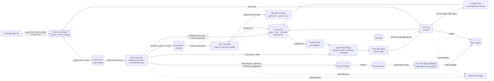

# MatchLens: the live explain layer for football

> **Inside the Game hackathon · Category: Best Azure Cloud Native Integration**
>
> **Live demo:** <https://wonderful-field-07003a80f.4.azurestaticapps.net> · **API:** <https://ca-api-bhdr37v3onmcs.thankfulglacier-9473c5b7.eastus2.azurecontainerapps.io/api/health> · **Video (< 2 min):** *coming soon*

Synthetic match events and 10 Hz tracking stream in. Timed, **verified** overlays stream
out. They explain *why* each moment matters, written differently for an analyst and a
casual fan, in English, Spanish and Japanese. Under the hood, every hop is an
event on Azure, every number traces to code-computed evidence, and a killed
agent resumes exactly where it stopped.

## Judging this? Start here

1. Open the **live demo**. It picks the most recent match.
2. Toggle **Fan / Analyst** and **EN / ES / 日本語**. Every overlay changes register
   and language.
3. Click **Why?** on any overlay to see the evidence pack. The model may only use
   these numbers; a code verifier rejects anything else.
4. Open **Producer** → **Start a match**. This launches a new Container Apps Job
   execution, which plays a live match.
5. Open **Ask** and ask "Who has been the better team and why?" An Agent
   Framework agent answers by calling the **MatchLens MCP server on Azure
   Functions**, so every number comes from a tool.
6. Pick a **▶ Replay** in the match list. Finished matches are packaged by an
   **event-driven Container Apps Job** (Event Grid `FullTime` → Storage queue →
   KEDA). It re-simulates the match deterministically from its seed and
   includes every cue that aired. There is always something to watch, even
   when nothing is live.
7. Click **Chaos drill**. The next explanation kills a storyteller replica
   mid-workflow. Watch the run table: Service Bus redelivers the moment and the
   Agent Framework workflow **resumes from its Cosmos DB checkpoint** without
   calling the model again.

## How it works



| Stage (rule 4.1) | What MatchLens does |
|---|---|
| **Ingest** | A seeded, agent-based simulator (ACA Job) plays a fictional match at 1–30× speed into Event Hubs. Players have roles and 1–99 traits and teams have tactical styles; pressure, tackles, interceptions and chances emerge from positions. Events (passes, carries, pressures, tackles, interceptions, shots with xG and shot speed, fouls, cards, subs) plus 10 Hz tracking of 22 players and the ball |
| **Interpret** | Deterministic, idempotent metrics: xG, possession, pass accuracy, final-third entries, PPDA (match and rolling), momentum, a control-vs-chaos index, distance, top speed and sprints. A replay gives byte-identical state (tested) |
| **Explain** | Detectors raise moments (goal, big chance, momentum swing, pressing surge, half time and full time) with an **evidence pack**. An Agent Framework workflow (Editor → Explainer → Verifier → Director) writes the *why* |
| **Render** | Machine-readable `OverlayCue`s with `display_at_s`, TTL, priority and template, timed against a 10 s broadcast delay so agent latency is invisible. Shown on a live 2D pitch with lower-thirds, player speed tags and recap panels |
| **Personalize** | Analyst vs casual register, three languages (one non-Latin), all from one structured model call per moment. Recaps are also **voiced** in each language |

### Three latency paths

| Path | Example | Who writes it | Budget |
|---|---|---|---|
| Hot | Goal, card, sub, 30 km/h speed tag, shot xG | Interpreter template, no LLM | < 1–3 s |
| Warm | Momentum swing, pressing surge, big chance | Agent workflow, verified | ~6–10 s, hidden by the broadcast delay |
| Cold | Half-time and full-time recap | Agent workflow (longer budget) | < 60 s |

## Why it's cloud native

- **Event-driven end to end.** Job → Event Hubs → Container Apps → Service Bus
  sessions → Container Apps → Cosmos DB change feed → Functions → Web PubSub →
  browser. No polling anywhere on the hot path.
- **Scales on the right signal.** KEDA scales the interpreter on **Event Hubs
  consumer lag** and the storyteller on **Service Bus queue depth**, both
  authenticated by **managed identity**. Everything scales to zero when idle.
- **Resilient by design.**
  - Per-match ordering comes from the partition key and Service Bus sessions.
  - Consumers are idempotent: deduplicated event ids and deterministic cue ids.
  - The interpreter snapshots state to Blob before every checkpoint.
  - The workflow checkpoints to Cosmos and resumes after a crash.
  - Model calls fall back from gpt-5-mini to gpt-4.1-mini to deterministic
    localized templates.
- **Keyless.**
  - Local auth is **disabled** on Event Hubs, Service Bus, Cosmos DB, Storage,
    Web PubSub, Foundry and Application Insights.
  - There is one user-assigned identity per service, with least-privilege roles
    written in Bicep.
  - ACR admin is off, and images are pulled by identity.
- **Automated.** `azd up` builds everything from an empty subscription. CI
  runs lint, tests, a Bicep build, the web build and an image smoke test. A
  keyless OIDC deploy workflow is included.
- **Observable.** OpenTelemetry flows to Application Insights (Entra-auth).
  Every cue carries the `trace_id` of the simulator second that caused it.
  There is a multi-region availability test with an alert, and an
  **Azure Monitor workbook "MatchLens: live SLOs"** deployed as code
  ([`infra/workbooks/slo.json`](infra/workbooks/slo.json)). It shows event →
  screen latency percentiles, replicas per service, agent/fallback/resume
  outcomes, model failures, resilience events and replays.
- **Guarded for a public demo.** Per-client rate limits, a global question
  budget, and caps on agent tool calls, round trips and wall time
  (`FunctionInvocationConfiguration`).

## Evidence

| Claim | Measured | Source |
|---|---|---|
| Scales on the right signal | 10 simultaneous matches at 6×: interpreter **1 → 4** replicas (Event Hubs lag), storyteller **0 → 4** (Service Bus depth) | [`docs/evidence/loadtest-20261009-0742.md`](docs/evidence/loadtest-20261009-0742.md) |
| Hot path is live | Event Hubs enqueue → cue pushed to Web PubSub: **p50 202 ms, p95 364 ms** (119 cues, server side); p50 235 ms on a viewer's WebSocket | same |
| Agents keep up | Agent-written, verified explanations: **p50 10.2 s**. The 10 s broadcast delay hides it. p95 58 s during scale-from-zero | same |
| Survives a crash | Storyteller killed mid-workflow; ACA restarts it, the Service Bus session is reclaimed, and MAF resumes from the Cosmos checkpoint in **51 ms** without calling the model again | [`docs/PROGRESS.md`](docs/PROGRESS.md#checkpoint-3-deployed-to-azure-and-verified-end-to-end-2026-10-09) |
| Grounded explanations | 4/4 sample moments passed the code verifier first time; injected bad numbers and names are rejected (tests) | `tests/test_storyteller.py` |
| Realistic synthetic data | Agent-based engine calibrated to SkillCorner open data: passes/match **+3%**, pass completion **−4%**, shots **−2%**, distance/90 **+4%** (held-out seeds); goals, fouls and headers in normal ranges | [`docs/REALISM.md`](docs/REALISM.md) |

## Hero technologies

| Technology | Where |
|---|---|
| Azure Container Apps (+ Jobs, KEDA) | `infra/modules/aca.bicep`: api, interpreter, storyteller and the simulator job |
| Azure Functions (Flex Consumption) | `functions/cue_publisher`: Cosmos change feed → Web PubSub, plus the **match-data MCP server** (4 MCP tool triggers) |
| MCP (Azure Functions + Agent Framework client) | "Ask the match" agent and GitHub Copilot (`.vscode/mcp.json`, plus the Azure MCP Server) call the same tools |
| Logic Apps | `logic-keeplive`: keeps a live match on air for judges (managed identity → ARM) |
| Event Grid | `match-lifecycle` topic (CloudEvents, Entra-only); `FullTime` is routed to a Storage queue by the topic's own managed identity |
| Container Apps Jobs (event-driven) | `job-replay`: scales from zero on queue length (KEDA `azure-queue`, managed identity) and packages replays |
| Key Vault | Holds the only non-Entra secret (the MCP extension key), read by managed identity |
| Microsoft Foundry | `infra/modules/foundry.bicep`: project with pinned `gpt-5-mini` and `gpt-4.1-mini` deployments |
| Microsoft Agent Framework 1.21 | `src/matchlens/story/workflow.py`: checkpointed workflow with `CosmosCheckpointStorage` |
| Azure Cosmos DB (serverless) | State, cues, moments, runs and workflow checkpoints; change feed drives rendering |
| Azure Event Hubs / Service Bus | Stream backbone / moment queue with sessions |
| Azure Web PubSub | Live push to browsers, Entra-authorized |
| Azure Static Web Apps | The overlay player |
| Azure AI Speech | Half-time and full-time recaps voiced in English, Spanish and Japanese (Foundry resource, Entra auth), stored in private Blob storage and streamed by the API |
| Azure AI Evaluation (Foundry evaluators) | `scripts/evaluate.py`: groundedness **4.75/5**, coherence **3.88/5** on golden moments; a gate in the deploy workflow |
| Application Insights | OpenTelemetry for every service |
| azd + Bicep, GitHub Actions | One-command deploy, CI, keyless CD |

## Run it

```bash
# Everything, from an empty subscription
azd auth login && az login
azd up                        # provision + deploy (~20 min the first time)

# Core logic, no Azure needed
uv sync && uv run pytest      # simulator, interpreter, verifier, workflow, crash-resume

# Web player against your deployment
cd web && echo "VITE_API_URL=$(azd env get-value API_URL)" > .env.local && npm i && npm run dev
```

## Repo map

```text
src/matchlens/
  contracts.py        versioned data contracts (events, tracking, moments, overlay cues)
  world.py            fictional league, clubs and squads
  sim/                deterministic event engine + 10 Hz tracking
  interpret/          incremental metrics, template cues, moment detectors
  story/              Agent Framework workflow, code verifier, localized templates
  services/           simulator · interpreter · storyteller · api entrypoints
functions/cue_publisher/   Cosmos change feed → Web PubSub
web/                  React overlay player, Why? drawer, producer console
infra/                Bicep for everything (azd)
docs/                 competition brief, infra design, research, build log
```

## Synthetic data, honestly

Every match is generated by our own simulator. The league, clubs, players and
kits are fictional. No real match data, footage or trademarks are used, and the
project is not affiliated with any league or club. Simulator parameters are
**fitted** to licensed open data (SkillCorner, MIT) by `python -m
matchlens.calibrate.fit`. Only aggregates and parameters are committed. See
[docs/REALISM.md](docs/REALISM.md) and [NOTICE.md](NOTICE.md).

Overlays labelled **AI** are model-written and code-verified. Overlays labelled
**Data** are computed directly from events.
