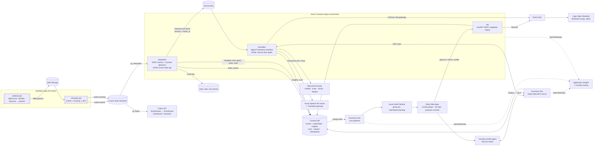

# MatchLens on Azure: infrastructure design

How we build MatchLens on Azure to win **Best Azure Cloud Native Integration**
while scoring well on all five judging criteria. Read
[COMPETITION.md](COMPETITION.md) first for the rules, the idea and the data
decisions.

Status: design, 2026-10-08; corrected against [INFRA-RESEARCH.md](INFRA-RESEARCH.md) the same day. Facts are tagged where it matters:

- **[V]**: checked against Microsoft Learn, an official repo or PyPI on
  2026-10-07/08.
- **[R]**: from Microsoft's own livestream reference app
  (`bbenz/football-results-dashboard`), which measured it on Azure on
  2026-09-30.
- **[E]**: an estimate or unverified. Check before relying on it, especially
  prices and model availability.

## 0. Decisions at a glance

| Decision | Choice | Why |
|---|---|---|
| Target category | Best Azure Cloud Native Integration | Fits a streaming, event-driven product. The category text names ACA, Functions, Logic Apps and AI-optimized data platforms |
| Core compute | **Azure Container Apps** (workload-profiles environment, Consumption) + **Azure Functions Flex Consumption** | Microsoft's reference guide says to start with ACA: 5 Bicep resources against 24 for AKS, cents a day against dollars [R]. KEDA scales on Event Hubs and Service Bus with managed identity [V]. Flex has scale-to-zero and always-ready instances [V] |
| AKS | Not in the core. Optional stretch: run the same images on AKS Automatic to prove portability | AKS Automatic costs ~$7–10/day idle and needs ~3× the deployment code [R] |
| Event backbone | **Event Hubs Standard** (tracking + events), **Service Bus Standard** (agent work, ordered per match), **Event Grid** (lifecycle events) | Basic Event Hubs allows only one consumer group [V]. We need at least 3 |
| State | **Cosmos DB for NoSQL** (serverless): event store, match state, insights, cues, viewer profiles, agent checkpoints | Change feed drives the render stage. Agent Framework ships `CosmosCheckpointStorage` [V] |
| Push to screens | **Azure Web PubSub** (Socket.IO), one group per match × persona × language | Managed WebSockets for a React client, with Functions bindings and Entra auth |
| Agents | **Microsoft Agent Framework (Python)** workflow running in an ACA app. Models, evaluations, tracing and an "Ask the match" hosted agent in **Microsoft Foundry** | Running the hot path on ACA keeps it event-driven and KEDA-scaled. Foundry still provides models, evals, traces, Toolbox and a hosted agent |
| Tools for agents | **Match-data MCP server on Azure Functions** (MCP tool triggers) | One tool contract shared by our agents, the Foundry agent and GitHub Copilot |
| Analytics platform | **Microsoft Fabric Real-Time Intelligence**: Eventstream → Eventhouse → Real-Time Dashboard + Activator | This is the "AI-optimized data platform" in the category text, and Fabric is a hero technology |
| Automation | **Logic Apps Standard** on Event Grid `FullTime` / `RecapReady` | Named in the category text. Distributes recaps and alerts |
| Frontend | React + TypeScript on **Azure Static Web Apps**: overlay player, fan app, producer console | "Balanced frontend and backend" is scored |
| IaC / delivery | **azd + Bicep** (Azure Verified Modules where they fit), **GitHub Actions with OIDC**, keyless everywhere | The same pattern as the reference app |
| Region | **East US 2** (fallback Sweden Central). Confirm model and hosted-agent availability on day 1 | Hosted agents, the GPT-6 family and the services above are expected there [E] |
| Budget | $300+ over the build and judging window | Allows Fabric capacity during demos, Event Hubs Standard, Web PubSub Standard and frontier models for recaps |

## 1. What the Cloud Native judges want, and how we show it

The category text, phrase by phrase:

| Category phrase | Our evidence |
|---|---|
| "AKS, Azure Container Apps, Functions, Logic Apps" | ACA for the services and simulator jobs, Functions for the MCP server and cue fan-out, Logic Apps for distribution. AKS only as a portability stretch |
| "AI-optimized data platforms" | Cosmos DB (change feed, vector search for the glossary), Fabric RTI Eventhouse with KQL, Eventhouse MCP for an analyst agent |
| "scalable" | KEDA scale rules on Event Hubs lag and Service Bus depth. An **Azure Load Testing** run of 20 simultaneous matches at 10× speed, shown as a replica-count and latency chart |
| "resilient" | Idempotent consumers, Event Hubs checkpoints, Service Bus dead-lettering and sessions, Cosmos workflow checkpoints, model fallback chain, template fallback. A **chaos drill** in the video: kill the agent worker mid-match, watch it resume |
| "event-driven architectures" | Every hop is an event: simulator → Event Hubs → interpreter → Service Bus → agents → Cosmos change feed → Functions → Web PubSub → browser. Lifecycle events go through Event Grid |
| "automation" | `azd up` from an empty subscription, GitHub Actions deployment, evaluation gate in CI, Logic Apps distribution, Fabric Activator alerts |
| "operational excellence" | OpenTelemetry to Application Insights with GenAI conventions, an SLO dashboard (p95 event→overlay latency, fallback rate, verifier rejects), budgets and alerts, a runbook |
| "AI capabilities" | Agent Framework agents, Foundry models with evaluations and tracing, Azure Speech HD voices, Translator with a glossary |
| "measurable business impact" | Numbers in the README: overlays per match, p95 latency, cost per match, languages served, verifier-blocked false claims |

## 2. Architecture



### Three paths with different latency budgets

| Path | Trigger | Budget | Who writes the overlay |
|---|---|---|---|
| **Hot** (facts) | Goal, card, substitution, sprint or speed threshold, shot speed | < 1 s from event to screen | The interpreter writes a **template cue** directly. No LLM |
| **Warm** (explanations) | A detector fires: momentum swing, pressing collapse, big chance, control→chaos flip | ≤ 8 s, hidden by a **broadcast delay** buffer (overlays are keyed to match clock + delay) | The agent workflow writes it, verified, per persona and language |
| **Cold** (recaps) | Half-time, full time | Under a minute | The recap agent (frontier model) writes text and audio, then emits `RecapReady` |

Real broadcasts already run several seconds behind live. We make that explicit:
the overlay player shows the feed at `match_clock − delay`, so LLM latency is
absorbed rather than visible.

## 3. Components

### 3.1 Synthetic data: `calibrate` and `simulator` (ACA jobs)

- **`calibrate`** (manual trigger, runs offline):
  - Downloads SkillCorner (MIT), IDSSE (CC BY 4.0) and Wyscout (CC BY 4.0) into
    a private blob container `raw-open-data/`. The data is never committed to git.
  - Loads them with `kloppy` 3.19.1 [V].
  - Fits simulator parameters: event rates per phase, pass length and angle
    distributions, shot-location density and our xG model, speed and sprint
    profiles, pressure distances, possession durations, formation shapes.
  - Writes `params/<version>.json` plus a **realism report** to Blob.
    Versions are content-addressed (hash of inputs + code version), as in the
    reference app's ingest [R].
- **`simulator`** (manual or scheduled trigger):
  - Plays a fictional fixture from a seed and a parameter version.
  - Emits events (passes, carries, shots, tackles, interceptions, pressures,
    possession changes, fouls, cards, subs, metadata) and tracking frames
    (22 players + ball, 10 Hz default, 25 Hz option) to Event Hubs.
  - Runs in real time or at 1–60× speed.
  - Scripted "stories" (pressing collapse at 55', comeback) give the demo
    known moments to detect and test against.
- **Why jobs:** they run to completion, retry once, bill per second, and can be
  started from CI or the producer console (`az containerapp job start`).
  Parallel executions give us the load test for free: 20 simulator executions
  means 20 live matches.

### 3.2 Event backbone

| Resource | Config | Notes |
|---|---|---|
| Event Hubs namespace | **Standard**, 1 TU, auto-inflate to 4 | Standard gives multiple consumer groups, Capture and a Kafka endpoint [V] |
| Hub `match-events` | 4 partitions, key = `match_id`, retention 1 day | Partitioning by match keeps each match in order |
| Hub `match-tracking` | 4 partitions, key = `match_id` | One message per **1 s batch of frames** per match (~10–25 frames × 23 entities ≈ 5–15 KB). 20 matches ≈ 300 KB/s, inside 1 TU (1 MB/s in) [E] |
| Consumer groups | `interpreter`, `fabric`, `archive` | One per downstream reader |
| Capture | **Off by default.** Capture costs an extra $0.10/hr (~$73/month) on Standard [V]. The interpreter writes the event log to Cosmos and Blob instead; turn Capture on only for a demo day | Archive for replays and evaluation sets |
| Service Bus namespace | **Standard**; queue `moments` with **sessions** (session id = `match_id`), dead-letter on, max delivery 3 | Sessions give per-match ordering with competing consumers across matches. Poisoned work is dead-lettered |
| Event Grid | Custom topic `match-lifecycle`: `MatchStarted`, `HalfTime`, `FullTime`, `RecapReady`, `SloBreached` | Discrete events, consumed by Logic Apps and Functions |

### 3.3 `interpreter` (ACA app, Python)

- Consumes `match-events` and `match-tracking` through the `azure-eventhub`
  SDK, with checkpoints in Blob.
- **KEDA scale rule:** `azure-eventhub` on consumer-group lag, managed
  identity auth [V]. 0–8 replicas; min 1 during demos to avoid cold starts.
- Runs the SPEC's **deterministic metrics incrementally** (see SPEC §6):
  - Savitzky–Golay smoothing on rolling windows; speed, acceleration, distance
    bands, sprints
  - ball speed and shot speed; pass distance, accuracy and difficulty (receiver
    space, defenders bypassed)
  - possession (event- and tracking-based), field tilt, xT and xG (our models),
    momentum, PPDA and counterpress over rolling windows
  - a control-vs-chaos index, team shape
  - pitch control only at moments, never every frame
- **Moment detectors** emit work items to Service Bus. Each carries an
  **evidence pack**: metric values before and after, deltas, event IDs, and a
  flag for each metric saying whether it supports or contradicts the story.
- Writes a **template cue** for hot-path facts straight to Cosmos `cues`.
- **Idempotent:** event IDs are deduplicated per match, and state is a pure
  function of the event log, so replaying gives identical state. A property
  test enforces this.

### 3.4 `storyteller` (ACA app, Agent Framework workflow)

- **KEDA scale rule:** `azure-servicebus` on queue depth, managed identity.
  0–10 replicas.
- **Microsoft Agent Framework (Python)**: pin `agent-framework==1.21.0`
  (released 2026-10-08 [V]). Minor releases have shipped breaking changes, so
  upgrade on purpose in its own PR.
- **Workflow graph** (MAF `WorkflowBuilder`):

  ```text
  Editor ──► Explainer ──► Verifier ──ok──► Director ──► Personalizer (fan-out per segment) ──► Verifier ──► cues
                 ▲             │                                         │
                 └──retry(1)───┘                      fail ──► template tier (localized, deterministic)
  ```

  | Agent | Job | Model tier |
  |---|---|---|
  | Editor | Rank detected moments, decide what airs, de-duplicate, respect a per-minute overlay budget | Small/fast |
  | Explainer | Write the *why* from the evidence pack only, with structured JSON output and evidence IDs | Mid |
  | Verifier | **Code first:** every number, player, club and claim must match the evidence pack or MCP state. An LLM checks only tone and policy. A model never grades its own work | Code + small |
  | Director | Pick the overlay template (lower-third, player tag, pitch graphic, momentum bar), priority, TTL and `display_at`; avoid collisions | Code + small |
  | Personalizer | Fan out concurrently over active segments (depth × club side × language × player focus) and rewrite in each register | Small/fast; Translator glossary for short strings |
  | Recap writer | Half-time and full-time recaps, a key-moments timeline, audio script | Frontier |

- **Shared state and recovery:**
  - `CosmosCheckpointStorage` saves a checkpoint at each superstep [V], so a
    killed replica resumes on another one.
  - Service Bus sessions and peek-lock mean an unfinished work item is
    redelivered.
  - Every model call has a timeout, retry with backoff, then a **fallback
    chain**: primary deployment → secondary deployment → template tier.
- **Human in the loop:** in "broadcast" mode, cues wait for producer approval
  (MAF `request_info`). The producer console approves, holds or retracts. A
  retraction emits a correction cue (compensating action).
- **Model access:** Foundry project endpoint over the Responses API, with an
  Entra token from the app's managed identity. No API keys, as in the
  reference app [R].

### 3.5 Microsoft Foundry

One **Foundry resource + project** (new model, not a hub; "classic" hub
projects are legacy [E]).

- **Model deployments** (Global Standard, pinned versions,
  `versionUpgradeOption: NoAutoUpgrade` [R]):

  | Tier | Candidate | Use |
  |---|---|---|
  | Small/fast | `gpt-5.4-mini` / `gpt-5.4-nano` or GPT-6 Luna [E] | Editor, Personalizer, Verifier tone check |
  | Mid | GPT-6 Sol ($2 / $10 per 1M tokens in/out [R]) | Explainer |
  | Frontier | GPT-6 Astra ($10 / $50 per 1M [R]) | Recaps, evaluation judge |

  **GPT-6 and gpt-5.5 need a quota request on lower quota tiers**; only Tier 5
  and 6 subscriptions get them by default [V]. A new pay-as-you-go subscription
  will be at a low tier, so file the GPT-6 Sol/Astra quota request on day 1 and
  build on `gpt-5.4-mini`/`nano` (or `gpt-5.6-luna`) until it is approved. The
  template tier means the demo still works if quota never arrives. Azure for
  Students subscriptions also get only **15 Flex Consumption cores per region**
  and no global batch quota [V], so keep the shared deployment on pay-as-you-go.
- **Evaluations:** `azure-ai-projects` 2.8.0 [V].
  - Built-in evaluators: groundedness, tool-call accuracy, coherence, fluency,
    safety, plus a rubric evaluator for "explanation faithfulness" and
    "persona fit".
  - Data: golden synthetic matches with scripted moments.
  - Runs as a **GitHub Actions gate** before deploy.
- **Tracing:** Agent Framework emits OpenTelemetry. Connect the project to our
  Application Insights so traces appear in Foundry's tracing view.
- **Foundry hosted agent "Ask the match"**:
  - A conversational agent for fans ("why are we losing midfield?").
  - Hosted agents are **GA** [V]. The Python hosting package
    `agent-framework-foundry-hosting` is still a prerelease (`1.0.0b261008` [V]).
    Deploy with `azd` (`azd ext install azure.ai.agents`).
  - Uses the Responses protocol. Sandbox sizes are 0.5 vCPU/1 GiB, 1/2 or
    2/4, and each agent gets its own Entra identity [V].
  - Tools come from a **Foundry Toolbox** pointing at our MCP server.
  - This puts Foundry in the product without moving the hot path off ACA.
- **Don't use** Foundry *workflows* (the visual designer). It retires on
  **2026-12-01**, and Microsoft says to use Agent Framework instead [V].
  Prompt flow is also retiring [E].
- Guardrails and content filters stay on. Event payloads are untrusted input,
  so scan tool responses too.

### 3.6 Match-data MCP server (Functions Flex)

- Azure Functions **MCP extension** (tool triggers, streamable HTTP at
  `/runtime/webhooks/mcp`) in Python. Foundry's guidance prefers Functions for
  custom MCP servers [V]. Template: `Azure-Samples/remote-mcp-functions-python`.
- **Tools** (read-only, typed, aggregates only):
  - `get_match_state`, `get_window_stats(t0, t1)`, `get_event_chain(event_id)`
  - `get_player_profile`, `get_physical_load`, `get_pass_network`
  - `get_pitch_control(at)`, `compare_to_baseline`, `get_moment_evidence(moment_id)`
- **Auth:** Entra (App Service Authentication with the project's managed
  identity as the allowed caller), not anonymous [V guidance].
- **Consumers:** the storyteller agents, the Foundry hosted agent (through
  Toolbox), and **GitHub Copilot agent mode** via `.vscode/mcp.json`, which
  covers the Copilot hero technology.

### 3.7 Render: cue publisher, Web PubSub, frontend

- **Cue publisher** (Functions Flex): a **Cosmos DB trigger** on the `cues`
  change feed publishes each cue to Web PubSub groups
  `match:{id}:p:{persona}:l:{lang}` through the output binding. Set
  **always-ready = 1** during demos to remove cold starts [V].
- **Web PubSub:** Free tier for development, **Standard (1 unit)** during
  judging [E pricing]. Clients get access tokens from a negotiate endpoint on
  `api`; the service itself uses Entra auth.
- **Overlay cue contract** (JSON Schema, versioned):

  ```json
  {
    "cue_id": "c-01J...", "schema_version": "1.0", "match_id": "m-042",
    "display_at": "54:12.0", "ttl_s": 8, "priority": 2,
    "template": "lower_third.momentum_swing", "persona": "casual", "lang": "es",
    "text": "...", "data": { "...": "..." },
    "evidence": { "event_ids": ["e-1881", "e-1890"], "metrics": ["ppda_5m", "field_tilt_10m"] },
    "verified": true, "source": "agent|template", "trace_id": "..."
  }
  ```

- **Frontend** (React + TypeScript on Static Web Apps):
  - **Overlay player**: a live 2D pitch from tracking, cues scheduled by match
    clock, and a "Why?" evidence drawer on each graphic.
  - **Fan app**: depth (analyst or casual), club, followed player, language,
    single-metric mode, two viewers side by side.
  - **Producer console**: queue of pending cues, approve/hold/retract, model
    health, SLO tiles, a "chaos" button for the demo.

### 3.8 `api` (ACA app, FastAPI)

- External ingress with HTTPS on `*.azurecontainerapps.io` [R].
- REST for viewer profiles, match list, replay packages, producer actions, and
  the Web PubSub negotiate endpoint.
- Revisions with traffic splitting give a blue/green deploy we can show [R].

### 3.9 Fabric Real-Time Intelligence (the "AI-optimized data platform")

- **Eventstream** reads `match-events` and `match-tracking` through the
  `fabric` consumer group into an **Eventhouse** (KQL database).
- **Real-Time Dashboard**: the analyst and studio view (possession waves,
  sprint heatmaps, pressing intensity across all live matches).
- **Activator**: rules such as "momentum swing > X" or "player top speed
  > 9.5 m/s" raise alerts. These can also feed Event Grid or Teams.
- **Eventhouse MCP** (preview [E]): an "analyst" tool for the Ask-the-match
  agent, so it can answer questions over the live KQL history.
- **Capacity:** first try a **Fabric trial** on the .edu tenant. The trial
  excludes Copilot and data-agent features, which we don't need [E]. Otherwise
  use **F2 pay-as-you-go** (~$0.36/hr, ~$263/month if left on [E]), **paused when not demoing**.
  The trial is F4 or F64 for 60 days and normally needs a work/school Entra account;
  a personal-email route via an Azure account is documented [V]. Fabric is a hero
  technology but **not required** by the rules [V].

### 3.10 Logic Apps Standard (automation)

Triggered by Event Grid:

- **`FullTime` → recap distribution:** fetches the recap (text, audio URL,
  key moments), formats it per language, and sends it by email or Teams.
- **`SloBreached` → ops notification:** a GitHub issue through the GitHub
  connector, with a link to the App Insights query.

Logic Apps agent workflows (Standard) are GA [E] and could replace a coded
step. They're optional; the connectors alone satisfy the category wording.

### 3.11 Azure AI Services

- **Azure Speech** HD neural voices: audio recaps per language and optional
  short commentary stings. Use stock voices only; never imitate a real
  commentator.
- **Azure Translator** with a **custom glossary** so club, player and metric
  names never get translated. LLMs write long-form text natively in the target
  language.

### 3.12 Supporting resources

| Resource | Purpose |
|---|---|
| Azure Container Registry (Basic) | Images, deployed by **digest** [R] |
| Storage account (ADLS Gen2) | `raw-open-data/` (private), `params/`, `raw-archive/`, `replays/`, Event Hubs checkpoints |
| Key Vault | Only for the few non-Entra secrets (ideally none) |
| Log Analytics + Application Insights | Telemetry for everything, local auth disabled [R] |
| Azure Load Testing | 20 matches × 10× replay, scripted |
| Budgets | Alerts at 50/80/100% |
| *(Stretch)* AKS Automatic | Same images, Gateway API ingress, KEDA, as a portability proof [R] |
| *(Stretch, probably skip)* API Management AI gateway | `llm-token-limit` and backend circuit breakers are **not on Consumption**; the cheapest tier with them is Basic v2 (~$150/month) [V]. Enforce token caps in our own middleware instead |
| *(Stretch)* ACA serverless GPU (T4) | Auto-eventing CV on synthetic rendered video. **Not available in East US 2**; Sweden Central has T4 and A100 [V]. Needs a quota request |

## 4. Data contracts

Versioned JSON Schemas in `schemas/`, validated at ingest, in tests and in CI.
They take the SPEC's canonical model and make it streamable.

| Contract | Key fields |
|---|---|
| `MatchEvent` | `event_id`, `match_id`, `seq`, `period`, `clock_s`, `type`, `team_id`, `player_id`, `x`, `y`, `end_x`, `end_y`, `outcome`, `body_part`, `under_pressure`, `qualifiers{}`, `source` (`sim`/`cv`), `confidence`, `schema_version` |
| `TrackingBatch` | `match_id`, `period`, `t0_s`, `fps`, `frames[{frame, t_s, ball{x,y,z}, players[{id, team, x, y, detected}]}]` |
| `MatchMetadata` | Fictional teams, squads, formations, pitch size (105×68 m), kick-off, `sim_params_version`, `seed` |
| `Moment` | `moment_id`, `kind`, `window`, `evidence_pack{metrics[before, after, delta, consistent]}`, `event_ids[]` |
| `Insight` | `claim`, `evidence_ids[]`, `confidence`, `verified`, `persona`, `lang` |
| `OverlayCue` | See §3.7 |
| `ViewerProfile` | `depth`, `club`, `player_focus`, `lang`, `single_metric`, `accessibility` |

**Coordinates:** metres, origin at the centre, and both teams attack
left→right after normalisation, as in SPEC §5.

**Cosmos containers** (serverless, partitioned on `/matchId` except
`viewers`): `events`, `matchState`, `moments`, `insights`, `cues`, `viewers`
(`/viewerId`), `checkpoints`, `glossary` (vector index for definitions).

## 5. Identity, security and networking

- **Keyless, as in the reference app** [R]:
  - User-assigned managed identity per service, each with least-privilege
    roles: Event Hubs Data Receiver/Sender, Service Bus Data
    Receiver/Sender, Cosmos DB built-in data roles, Foundry User, Storage Blob
    Data Reader/Contributor, Web PubSub Service Owner, Monitoring Metrics
    Publisher, AcrPull.
  - Local (key) auth disabled on Foundry, Storage, App Insights, Event Hubs,
    Service Bus and Cosmos where supported.
- **Local development:** `DefaultAzureCredential` from `az login`.
  Containers get a short-lived token file, refreshed every 15 minutes [R].
- **CI/CD:** GitHub Actions authenticates with **OIDC federated credentials**.
  No secrets are stored.
- **Ingress:**
  - `api` is external. **Do not** IP-restrict it: rule 4.8 requires free, unrestricted
    judge access until Nov 10. Use per-client rate limits instead.
  - `interpreter`, `storyteller` and the MCP server are internal or
    Entra-protected.
  - Static Web Apps serves the UI.
- **Judge access:** the public URL stays open until **Nov 10**. Add per-client
  rate limits and a token budget per visitor, so a judge can't drain the
  model quota and a bot can't run up the bill.
- **Responsible AI:**
  - Overlays are labelled AI-generated.
  - No betting or odds features.
  - Guardrails scan tool responses.
  - Prompt-injection tests on event free-text fields.
  - Content filters stay on.

## 6. Observability and SLOs

- **OpenTelemetry everywhere** (Azure Monitor distro, Entra-authenticated), with
  W3C trace context from the simulator event to the browser cue. The
  `trace_id` travels in every cue.
- Spans follow the **GenAI semantic conventions** (`gen_ai.*`) [R]. Prompts
  and responses are not logged in production.
- **SLOs on one Azure Monitor workbook**:
  - p95 event→template cue < 1 s
  - p95 moment→verified cue < 8 s
  - fallback rate < 10%
  - verifier reject rate (tracked)
  - tokens and cost per match
  - KEDA replica counts
- **Alerts:** an SLO breach → Event Grid `SloBreached` → Logic App → GitHub
  issue.
- Every page shows a trace ID. A `/trace/<id>` view renders the spans
  immediately, without waiting for cloud ingestion [R].

## 7. Resilience: what we prove, and how

| Failure | Mechanism | Demo |
|---|---|---|
| Duplicate or out-of-order events | Event ID deduplication; per-match ordering via partition key and Service Bus sessions | Replay the same match twice and get identical state |
| `storyteller` replica killed mid-match | Cosmos workflow checkpoints; Service Bus redelivery | **Chaos button** in the producer console (our own fault endpoint + `az containerapp revision restart`; **Chaos Studio has no ACA target** [V]); the trace shows the resume |
| Broker outage | Chaos Studio fault on **Event Hubs / Service Bus** (disable the hub/queue for 60 s) [V] | Backlog builds, KEDA scales out on recovery, overlays catch up inside the broadcast delay |
| Model 429 or outage | Timeout → retry → secondary deployment → template tier | Model-health switch; overlays keep landing on time |
| Hallucinated number | The code verifier blocks it, one retry, then template | Show a blocked claim in the evidence drawer |
| Load spike | KEDA scales `interpreter` and `storyteller` | Load test chart: 20 matches at 10×, replicas vs p95 latency |
| Bad release | ACA revisions: deploy v2 at 0%, then split 50/50, roll back in seconds [R] | Optional, in the README rather than the video |

## 8. Infrastructure as code and delivery

```text
infra/
  main.bicep                 # azd entry point, subscription scope → resource group
  modules/
    foundation.bicep         # Log Analytics, App Insights, budget, Key Vault
    foundry.bicep            # Foundry resource + project, pinned model deployments
    messaging.bicep          # Event Hubs (Capture off by default), Service Bus, Event Grid topic
    data.bicep               # Cosmos DB, Storage (ADLS), containers
    aca.bicep                # environment, apps (api, interpreter, storyteller), jobs (simulator, calibrate), KEDA rules
    functions.bicep          # Flex apps: mcp, cue-publisher
    realtime.bicep           # Web PubSub hub + event handlers
    web.bicep                # Static Web Apps
    logicapps.bicep          # Logic Apps Standard + Event Grid subscriptions
    identity.bicep           # user-assigned identities + role assignments
  aks/ (stretch)
azure.yaml                   # azd services + Foundry hosted agent
```

- **`azd up`** goes from an empty subscription to a running system in one
  command. `azd down --purge` tears it all down.
- Use **Azure Verified Modules** (`br/public:avm/res/...`) where they fit. Pin
  module versions.
- **GitHub Actions:**
  1. lint (ruff, mypy, eslint), unit tests
  2. contract tests against the JSON Schemas
  3. **golden-match replay** with a mocked model
  4. `bicep build` + `azd provision --preview`
  5. build and push images (by digest)
  6. deploy
  7. smoke test
  8. **Foundry evaluation gate**
  9. load-test job (manual trigger)
- **GitHub Copilot:**
  - Agent mode with Azure MCP Server, GitHub MCP and our match-data MCP
  - `.github/copilot-instructions.md`
  - cloud agent for issue-to-PR work
  - Note: students now get a separate **"Copilot Student"** plan (limited
    chat/agent use, auto model selection), not free Copilot Pro. Sign-ups were
    paused on 2026-04-20 and began reopening on 2026-06-17 [V]. Check each
    teammate's plan now.

## 9. Region, quotas and accounts

1. **Subscription.** Fastest route: one **pay-as-you-go** subscription owned
   by the team lead, with the budget alert set at creation. Each student can
   also claim **Azure for Students** ($100 credit, no card, 12 months, new
   customers only). Use those as personal dev sandboxes, not for the shared
   deployment, because quotas on them are low.
2. **Region:** `eastus2`. On day 1, check availability for: Foundry hosted
   agents, the chosen models, Web PubSub, Fabric capacity, ACA workload
   profiles, Load Testing. Fall back to `swedencentral` for Foundry if models
   are missing, and keep the rest in one region.
3. **Quotas to request on day 1:** model TPM for each deployment, ACA cores
   (if we use dedicated profiles), Functions Flex cores (trials get 15 per
   region [E]).
4. **Register providers:** `Microsoft.App`, `Microsoft.EventHub`,
   `Microsoft.ServiceBus`, `Microsoft.EventGrid`, `Microsoft.DocumentDB`,
   `Microsoft.SignalRService`, `Microsoft.Web`, `Microsoft.Logic`,
   `Microsoft.CognitiveServices`, `Microsoft.LoadTestService`,
   `Microsoft.Fabric`, `Microsoft.PolicyInsights`.

## 10. Cost estimate (Oct 8 – Nov 10)

List prices, not checked in the calculator yet [E] except where marked.
Scale to zero whenever we aren't demoing.

| Item | Config | Est. cost for the window |
|---|---|---|
| Container Apps | Consumption; free grant 180k vCPU-s + 360k GiB-s + 2M requests/month [R]; min replicas 1 during demos | $10–40 |
| Functions Flex | On demand; always-ready 1 on two apps during judging | $5–30 |
| Event Hubs Standard | 1 TU (~$22/month) | ~$25 |
| Service Bus Standard | Base fee | ~$10 |
| Event Grid | Per-operation | <$1 |
| Cosmos DB | Serverless | $5–25 |
| Web PubSub | Free for dev → Standard 1 unit for judging (~$49/month) | ~$50 |
| Static Web Apps | Free (Standard $9 if custom auth is needed) | $0–9 |
| Model tokens | ~1–5M tokens per full match on mid/small models; recaps on Astra | $30–120 |
| Fabric | Trial if eligible; otherwise F2 (~$0.36/hr) paused when idle | $0–80 |
| Logic Apps Standard | WS1 plan, or stopped between demos | $20–60 |
| Speech + Translator | Pay-as-you-go | $5–20 |
| Load Testing (billed as "Azure App Testing") | ~$0.15/VUH, 100 free test-minutes for 30 days [V] | $0–15 |
| App Insights / Log Analytics | Daily cap 1 GB | $5–20 |
| ACR Basic | ~$0.17/day [R] | ~$6 |
| **Total** | | **~$180–500** |
| *Stretch:* AKS Automatic | ~$7–10/day while running [R]; only for a demo day | +$20–50 |

Cost controls:

- Budget alerts.
- Scale-to-zero by default.
- A nightly GitHub Action scales the demo environment down.
- Pause the Fabric capacity when idle.
- A per-viewer token cap.
- Template-first overlays (no LLM for plain facts).
- One structured model call returns every persona and language variant.

## 11. Build plan to Oct 27

| Dates | Infra | Product |
|---|---|---|
| **Oct 8–9** | Subscription, budget, region check, **model quota requests**, provider registration, `azd` skeleton, Foundry project + one deployment, GitHub OIDC | Register the whole team. Write the schemas. Port SPEC metrics to streaming |
| Oct 10–12 | Event Hubs, Service Bus, Cosmos, Storage, ACA environment; `simulator` and `interpreter` deployed; App Insights wired | Simulator v1 (events + tracking); calibrate v1 from SkillCorner and IDSSE; realism report v1 |
| Oct 13–15 | Cue publisher Function, Web PubSub, Static Web Apps | Overlay player with template cues end to end. **Watch the Oct 14 livestream** |
| Oct 16–19 | `storyteller` with KEDA on Service Bus, Cosmos checkpoints, MCP server on Functions, model fallback chain | Agent workflow (Editor, Explainer, Verifier, Director, Personalizer), evidence drawer, persona and language switcher |
| **Oct 20 noon PT** | Registration closes | |
| Oct 20–22 | Fabric RTI (Eventstream, Eventhouse, dashboard, Activator), Event Grid + Logic Apps, Speech | Producer console with HITL; recaps with audio; Ask-the-match hosted agent |
| Oct 23–24 | Load test, chaos drill, SLO workbook, eval gate in CI | Polish, accessibility, three languages |
| Oct 25–26 | Freeze infra; judge-access hardening (rate limits, token caps) | **Record the video** (< 2:00), README "Judging this? Start here", architecture diagram |
| **Oct 27** | Submit by 23:59 PT, with buffer | |

If we slip, cut in this order: Fabric Activator, then Logic Apps agent
features, then the Ask-the-match hosted agent, then audio. **Never cut** the
event-driven core, the verifier, the overlays or the load/chaos evidence.

## 12. Risks

| Risk | Mitigation |
|---|---|
| Model quota too low on a new subscription | Request on day 1; use two regions for Foundry if needed; small models on the hot path; template tier keeps the demo working |
| Preview features (Eventhouse MCP, Foundry hosting SDK beta, guardrail previews) | Keep previews off the critical path, and label them as preview in the README |
| Agent Framework breaking changes | Pin exact versions; replay tests in CI; upgrade in dedicated PRs |
| Fabric trial unavailable to a .edu or personal tenant | F2 paid and paused; or make Fabric a stretch and lean on Cosmos + App Insights |
| Latency of LLM chains | Broadcast-delay buffer; one call per moment for all variants; concurrency; timeouts |
| Cost overrun from always-on resources | Budgets, nightly scale-down, Fabric pause, no AKS except on demo day |
| Data-licence challenge | Calibrate only from MIT / CC BY sources; commit parameters and aggregates only; NOTICE + datasheet; fictional world |
| IP in the video (real clubs, music) | Fictional brand pack; no music or licensed music only; disclaimers |
| Name clash with another "MatchLens AI" entry | Decide on a name early (see COMPETITION.md §8) |

## 13. What the 2-minute video must show

1. 0:00–0:10: the hook and the problem. A producer needs the *why*, live; a
   fan wants *their* view.
2. 0:10–1:00: a live match on the overlay player. A hot-path fact lands
   instantly. A momentum-swing explanation arrives, with the "Why?" drawer
   showing evidence IDs. The same moment then appears in analyst and casual
   modes and in a second language.
3. 1:00–1:25: Cloud Native proof. The architecture diagram, the load-test
   chart (replicas scaling with 20 matches), the chaos button (worker killed,
   workflow resumes), and the SLO workbook.
4. 1:25–1:45: the Fabric dashboard and an Activator alert; the Logic App
   delivering the recap.
5. 1:45–1:55: close with the repo URL and the synthetic-data disclaimer.

## Sources

- Rules and categories: <https://github.com/microsoft/insidethegamehackathon>
- Reference app [R]: <https://github.com/bbenz/football-results-dashboard>
  (`docs/ARCHITECTURE.md`, `docs/AKS-VS-ACA.md`, `docs/APPENDIX.md`,
  `docs/DEPLOYMENT.md`; measured 2026-09-30)
- Foundry hosted agents [V]: <https://learn.microsoft.com/en-us/azure/foundry/agents/concepts/hosted-agents>
- Foundry workflows retirement on 2026-12-01 [V]: <https://learn.microsoft.com/en-us/azure/foundry/agents/concepts/workflow>
- Build your own MCP server for Foundry [V]: <https://learn.microsoft.com/en-us/azure/foundry/mcp/build-your-own-mcp-server>
- Functions MCP bindings: <https://learn.microsoft.com/en-us/azure/azure-functions/functions-bindings-mcp>
- Functions Flex Consumption [V, ms.date 2026-09-15]: <https://learn.microsoft.com/en-us/azure/azure-functions/flex-consumption-plan>
- ACA scaling with KEDA (Event Hubs, Service Bus, managed identity) [V, ms.date 2026-05-19]: <https://learn.microsoft.com/en-us/azure/container-apps/scale-app>
- Event Hubs tiers (Basic: one consumer group) [V]: <https://learn.microsoft.com/en-us/azure/event-hubs/compare-tiers>
- Agent Framework releases [V]: <https://github.com/microsoft/agent-framework/releases>. PyPI on 2026-10-08: `agent-framework` 1.21.0, `agent-framework-foundry` 1.14.1, `agent-framework-foundry-hosting` 1.0.0b261008, `azure-ai-projects` 2.8.0, `kloppy` 3.19.1
- Azure for Students: <https://azure.microsoft.com/en-us/free/students>
- GitHub Copilot for students (sign-ups paused): <https://docs.github.com/en/copilot/how-tos/copilot-on-github/set-up-copilot/enable-copilot/set-up-for-students>
- Competitor Azure research (extensive; treat its [U] items as unverified): <https://github.com/anontrenchpaper/ms-epl-hackathon/blob/main/research/05-azure-microsoft-stack.md>
