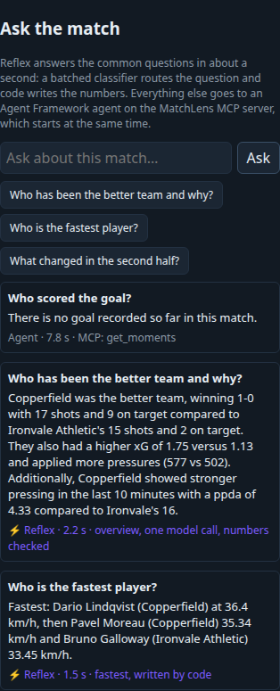

# Reflex: answering the easy questions before the agent does

"Ask the match" is an Agent Framework agent that answers through the
match-data MCP server on Azure Functions. That answer is grounded, but it is
slow. A turn is one model call to choose a tool, an MCP call, and a second
model call to write the answer. The Functions Flex MCP endpoint takes
**1.8 to 26 s** per tool call when its instances are cold (measured
2026-10-25, three calls). Asking "What's the score?" on the live site took
**21 s**, and "Who is the fastest player?" took **5.3 s**.

Most fan questions are one of a dozen kinds, and the answer is already in the
match state document. Reflex is a fast path in front of the agent for those
questions.

```
            ┌─► Probe: ~12 routing questions in ONE gpt-4.1-mini call ─┐
question ───┤                                                           ├─► decide ─┬─► Tier 0: code fills a template
            ├─► read matchState from Cosmos (in parallel) ─────────────┘           ├─► Tier 1: one tool-free call,
            │                                                                       │           numbers and names checked
            │                                                                       ├─► decline (betting)
            └─► MCP agent starts at the same moment ─────────── cancelled ◄─────────┤
                                                                answers ◄───────────┴─► pass
```

## The probe: a classifier made from a chat model

`src/matchlens/reflex/probe.py` turns a small chat model into a batched
classifier. Every question asks for one option letter. The probability of
each option comes from the **token logprobs** of that letter, not from the
model's own claim of confidence. Asking 1 question or 20 costs one round trip,
so Reflex asks everything a decision needs in a single request.

- **Checked choices.** Small models favour the first option they see. The
  routing question is asked twice in the same call, once forward and once
  reversed. It only counts when both orders pick the same option, and its
  confidence is the lower of the two.
- **Outcome-shaped fit checks.** For each capability Reflex asks: "Would a
  reply giving only *X*, and nothing else, fully answer the request?" This is
  what sends "Who is the slowest player?" and "Who scored the goal?" to the
  agent, even though they look like the fastest-player and score questions.
- **Untrusted text.** The question is collapsed to one line and JSON-quoted,
  and the system prompt says it is data. The probe only picks among options
  that code wrote, and its verdict never authorizes anything.
- **Any failure is a pass.** A timeout, a 429 or an unreadable answer sends
  the turn to the agent. It is never an error for the fan.

## Answer tiers

| Tier | What writes the answer | Capabilities |
|---|---|---|
| 0 | Code fills a localized template (en, es, ja) from the state document. No model writes a number. | score, xG, shots, possession, passing, pressing, fastest players, cards, last 10 minutes |
| 1 | One tool-free gpt-4.1-mini call writes from a ~1K-token brief. Every number must trace to the brief and every player named must be in it, or the turn goes to the agent. | "who has been better and why" overview |
| decline | Code | betting and odds |
| pass | The MCP agent, already running | everything else |

The Tier 1 check reuses the storyteller verifier's number matcher
(`story/verifier.py`). That is the same rule the broadcast overlays follow.

## The race

`POST /api/ask` starts the agent and Reflex together. If Reflex answers, the
API cancels the agent. If Reflex passes, the agent is already part-way through
its turn, so a pass adds no time. The cost is a cancelled agent model call on
the turns Reflex answers. That is cheap on gpt-4.1-mini, and global ask limits
already cap it.

Every response carries `reflex` telemetry: outcome, capability, tier,
confidence, the pass reason, and the probe and total time. The player shows it
as a badge on each answer. The API also logs one `reflex outcome=...` line per
question to Application Insights.

## Measured

`scripts/reflex/bench.py` runs Reflex with the live model on a recorded match
state (`tests/data/match_state.json`). A pass is never counted as wrong, only
as lost coverage. A wrong answer means Reflex answered with a capability the
label does not accept, or answered a question labelled for the agent. The dev
set (50 questions) was used to tune the capability descriptions. The test set
(34 questions) was written after tuning and scored once.

| Set | Answerable answered | Wrong answers | Tier 0 p50 | Tier 1 p50 | Probe p50 | Labels changed on a rerun |
|---|---|---|---|---|---|---|
| dev, 50 | 35 / 37 (95%) | 1 / 36 | 1.18 s | 2.17 s | 1.15 s | 1 / 50 |
| **test, 34** | **21 / 24 (88%)** | **1 / 22** | **1.12 s** | **1.85 s** | **1.14 s** | **3 / 34** |

The wrong test answer was "Which team had more possession in the first
half?". Reflex gave the whole-match split, but the state has no per-half data.
Two of the three rerun changes were Tier 1 answers that the grounding check
sent to the agent on one run and not the other. That is the check working.

End to end through the local API on the shared Azure resources: Tier 0
answers arrive in **1.2 to 2.0 s** and the Tier 1 overview in **2.0 to 2.2 s**.
The same questions take **5 to 21 s** on the agent path.



## Limits

- The probe is a real model call (~1.1 s), not a dedicated classifier. A
  logprob-capable model is required, so it runs on gpt-4.1-mini, not gpt-5-mini.
- The gpt-4.1-mini deployment allows 50 requests a minute. The storyteller
  fallback, the agent and Reflex all share it. Run the bench with `--rpm 30`
  (the default) or it will measure 429s.
- Reflex only knows what the state document holds. Questions about scorers,
  timelines, halves or single players go to the agent.

## Running it

```bash
uv run pytest tests/test_reflex.py                     # offline, fake model
uv run python scripts/reflex/bench.py --set dev        # live model, about 2 min per run (az login)
uv run python scripts/reflex/bench.py --set test --show
```
